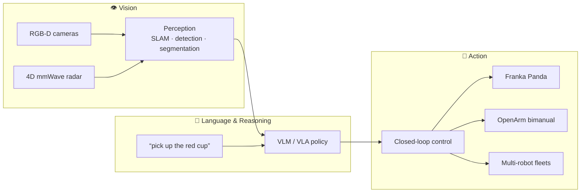

---

### 🤖 About me

I'm a **Research Engineer in Embodied AI and robot learning**. I teach robots to **perceive, reason, and act** in the physical world.

- 🧠 **Policy learning:** Vision-Language-Action (VLA) models, diffusion policies, imitation learning and RL, deployed on real manipulators
- 👁️ **Perception:** RGB-D and 4D mmWave radar fusion, SLAM, VLMs, real-time CUDA/TensorRT pipelines
- 🦾 **Systems:** multi-robot autonomy, 5G-connected AMRs, cobots (Franka Panda, OpenArm), ESP32 robot swarms
- 🎓 **MASc, Mechatronics Engineering, University of Waterloo**: worked with Apple, UW RoboHub, Keysight and Rogers on smart-factory robotics

### 🔁 How my work fits together

### 🚀 Featured research

| Project | What it does | Venue |
|---|---|---|
| 🛰️ [**CRADMap**](https://github.com/Maaz-qureshi98/CRADMap-Multi-Robot-Mapping) | Distributed volumetric mapping with 5G-connected multi-robots and 4D mmWave radar perception | **IEEE ICARM 2025** |
| 📡 [**RAPTAR**](https://github.com/Maaz-qureshi98/RAPTAR-Motion-Planning) | Autonomous hemispherical mmWave radar pattern measurement with a Franka Panda cobot (ROS, MoveIt) | **IEEE AP-S/URSI 2026** |
| 🐝 [**Swarm Autobots**](https://github.com/Maaz-qureshi98/Swarm-Autobots) | Decentralized formation control for ESP32 robot teams over ESP-NOW, from simulation to hardware | Publication in prep |
| 🦾 [**OpenArm CAN**](https://github.com/Maaz-qureshi98/OpenArm-CAN) | One-file bring-up and control for a bimanual OpenArm over CAN-FD | Tooling |
| 🌊 [**4D mmWave Radar ROS 2**](https://github.com/Maaz-qureshi98/Radar-ROS2_Perception-4DmmWave) | ROS 2 perception for Altos 4D mmWave radar | Tooling |
| 📶 [**5G Quectel drivers**](https://github.com/Maaz-qureshi98/5G-quectel-linux_drivers) | 5G modem drivers for Ubuntu 22.04 robots | Tooling |

### 🛠️ Toolbox

  

  
  
  
  
  
  
  

### 📈 Activity

  <picture>
    <source media="(prefers-color-scheme: dark)" srcset="https://raw.githubusercontent.com/Maaz-qureshi98/Maaz-qureshi98/output/snake-dark.svg"/>
    
  </picture>

  

🛠️ Building robots that understand what they see and do what they're told.

