<picture>
  <source media="(prefers-color-scheme: dark)" srcset="assets/vla-dark.svg">
  
</picture>

I build robots that perceive, reason, and act in the physical world. My work covers vision-language-action and diffusion policies on real manipulators, multimodal perception with RGB-D and 4D mmWave radar, and the real-time systems that run them across multi-robot platforms.

I hold an MASc in Mechatronics Engineering from the University of Waterloo, where I worked with Apple, UW RoboHub, Keysight, and Rogers on smart-factory robotics.

[Portfolio](https://maaz-qureshi98.github.io/Portfolio-Maaz/) · [Google Scholar](https://scholar.google.ca/citations?user=hC7tswoAAAAJ&hl=en) · [LinkedIn](https://www.linkedin.com/in/maaz-ahmad-046c/) · [Email](mailto:m23qures@uwaterloo.ca)

 

### Publications

**CRADMap: Applied Distributed Volumetric Mapping with 5G-Connected Multi-Robots and 4D Radar Perception** 
ICARM 2025 · [Paper](https://doi.org/10.1109/ICARM65671.2025.11293594) · [Code](https://github.com/Maaz-qureshi98/CRADMap-Multi-Robot-Mapping)

**Hemispherical Angular Power Mapping of Installed mmWave Radar Modules Under Realistic Deployment Constraints** 
IEEE AP-S/URSI 2026 · [Code](https://github.com/Maaz-qureshi98/RAPTAR-Motion-Planning)

 

### Selected work

| Project | Description |
|---|---|
| [CRADMap](https://github.com/Maaz-qureshi98/CRADMap-Multi-Robot-Mapping) | Distributed volumetric mapping across 5G-connected robots with 4D mmWave radar and RGB-D perception. |
| [RAPTAR](https://github.com/Maaz-qureshi98/RAPTAR-Motion-Planning) | Autonomous hemispherical radar pattern measurement with a Franka Panda, ROS, and MoveIt. |
| [Swarm Autobots](https://github.com/Maaz-qureshi98/Swarm-Autobots) | Decentralized formation control for ESP32 robot teams over ESP-NOW, from simulation to hardware. |
| [OpenArm CAN](https://github.com/Maaz-qureshi98/OpenArm-CAN) | Single-file bring-up and control for a bimanual OpenArm over CAN-FD. |
| [4D Radar for ROS 2](https://github.com/Maaz-qureshi98/Radar-ROS2_Perception-4DmmWave) | ROS 2 perception driver for the Altos 4D mmWave radar. |

 

### Tools

Python · C++ · CUDA · TensorRT · PyTorch · LeRobot · ROS 2 · MoveIt · ORB-SLAM3 · Docker · Swift / ARKit · ESP32
